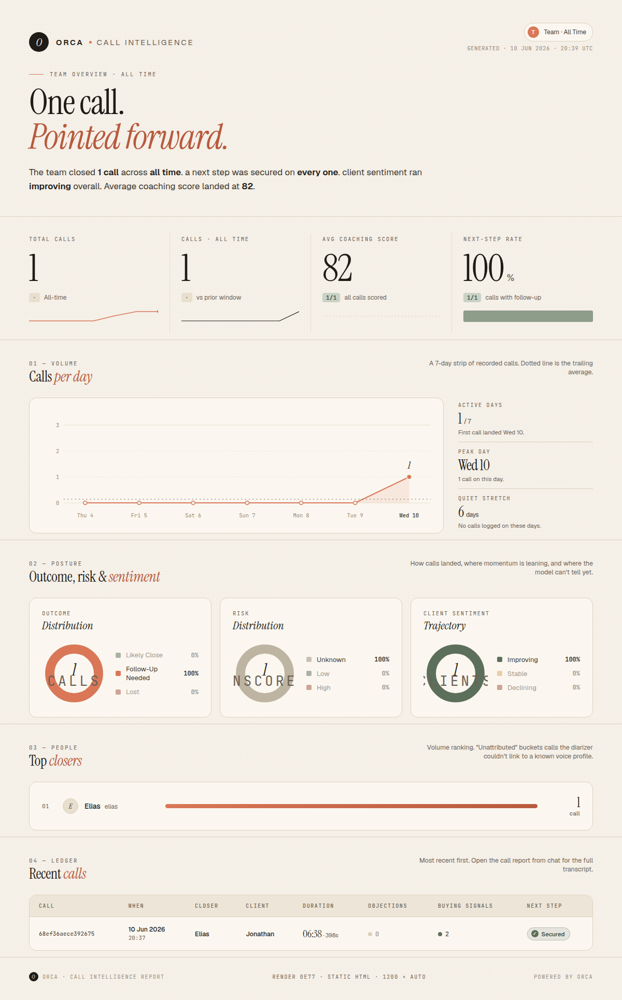
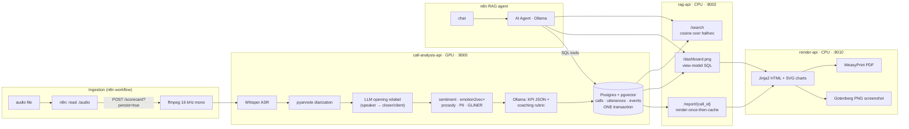
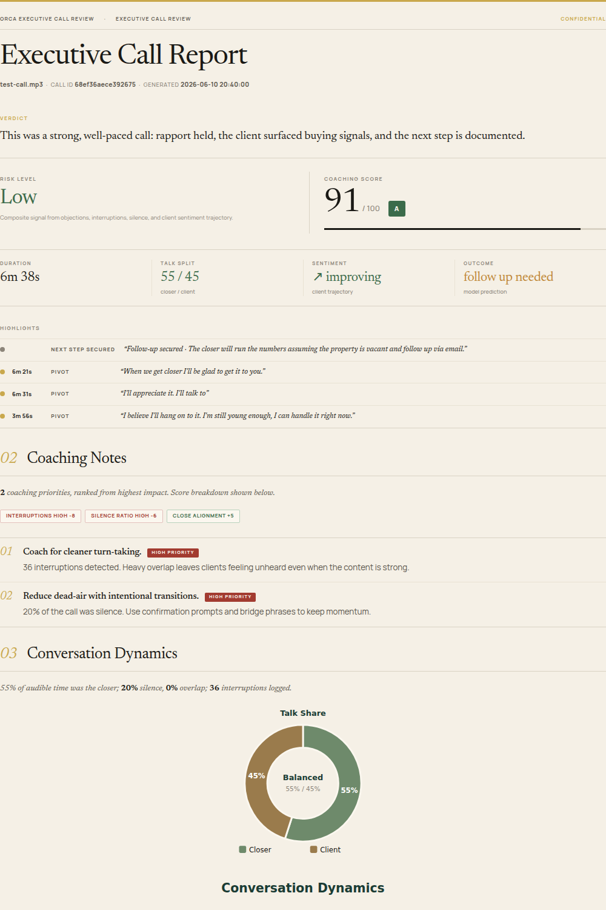
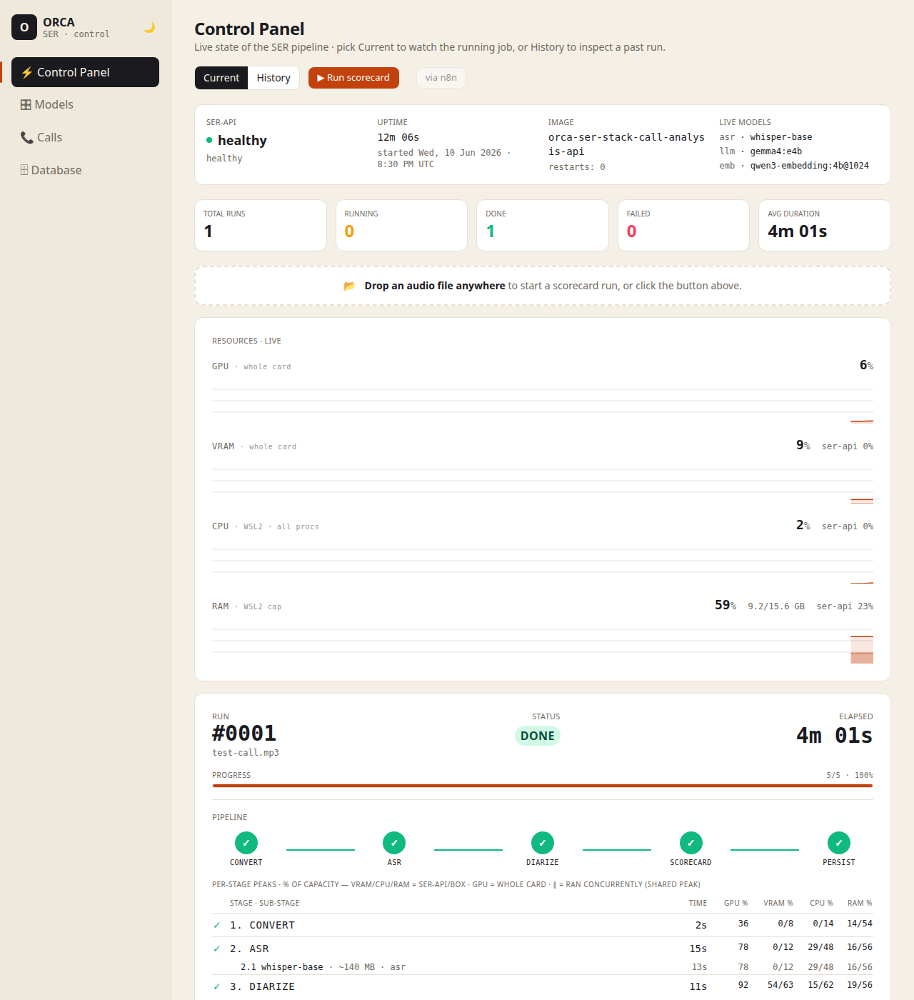

# ORCA — Self-Hosted Sales-Call Intelligence

**Speech Emotion Recognition + RAG pipeline for sales calls. 100% local, GPU-accelerated, one `docker compose up`.**

Drop a call recording in a folder → get back a fully analysed call: who spoke when, what they said, how they *felt* saying it, extracted KPIs, a coached scorecard, a branded PDF report, and a semantic search index you can chat with through an n8n RAG agent. No data ever leaves your machine.



| | |
|---|---|
| **ASR** | Whisper (faster-whisper / CTranslate2), word-level timestamps + confidence |
| **Diarization** | pyannote speaker-diarization 3.1 + LLM speaker→role relabel |
| **Speech emotion** | emotion2vec+ large (9-class) + derived valence/arousal/dominance |
| **Text sentiment** | RoBERTa (3-class), batched |
| **Prosody** | openSMILE eGeMAPS-v02 (88 functionals per speaker) |
| **Entities** | GLiNER zero-shot (competitors, price points, neighborhoods…) |
| **PII** | Microsoft Presidio + spaCy redaction stored alongside raw text |
| **KPIs + coaching** | Local LLM via Ollama (`format: json`), six-dimension coaching rubric |
| **Vector search** | pgvector `halfvec(1024)` + HNSW, Matryoshka-truncated Qwen3 embeddings |
| **Reports** | WeasyPrint PDF + pure-SVG charts, rendered on demand and cached |
| **Chat** | n8n AI agent with 4 tools (semantic search, SQL, dashboard-as-image) |

---

## Architecture



Five custom services, one shared package:

| Service | Port | Role |
|---|---|---|
| `call-analysis-api` | 8000 | GPU write path — the full audio→analytics pipeline |
| `rag-api` | 8002 | CPU read path — semantic search, dashboards, on-demand reports |
| `render-api` | 8010 | HTML/PDF renderer — WeasyPrint + hand-rolled SVG charts |
| `orca-ui-ser-control` | 8040 | Control center — live model hot-swap, run history, per-stage GPU/RAM peaks |
| `n8n` | 5678 | Orchestration + the RAG chat agent demo |
| `packages/ragcore` | — | Torch-free shared core (config, DB, embedding recipe) used by write *and* read paths |

Plus stock infrastructure: Postgres (`pgvector/pgvector:pg16`), Ollama, Gotenberg, Adminer.

---

## Quickstart

**Prereqs:** Docker Desktop (with WSL2 + NVIDIA GPU support on Windows, or nvidia-container-toolkit on Linux), an NVIDIA GPU with ~16 GB VRAM for the full experience, and a free Hugging Face token.

```bash
git clone <this repo>
cd <repo>

# 1. Configure — only HF_TOKEN is required.
cp .env.example .env
#    Get a token at https://huggingface.co/settings/tokens and accept the
#    gated-model licence at https://huggingface.co/pyannote/speaker-diarization-3.1

# 2. Bring the stack up (first run downloads ~25 GB of models — LLMs via
#    Ollama, audio models from HF/ModelScope. All cached in named volumes.)
docker compose --profile gpu-nvidia up -d

# 3. Drop a call recording into ./audio/ (mp3, wav, m4a, ogg, …)

# 4. Open n8n at http://localhost:5678, open the bundled workflow
#    "ORCA - SER Ingestion + RAG Chat", click Execute workflow.

# 5. Chat with your calls in the same workflow's chat panel,
#    or hit the API directly:
curl "http://localhost:8002/search?q=price%20objection&scope=utterances&top_k=5"
```

No GPU? `docker compose --profile cpu up -d` works — every model falls back to CPU — but expect minutes-per-call to become tens of minutes.

### What's where once it's running

| URL | What |
|---|---|
| `http://localhost:5678` | n8n — bundled ingestion + RAG chat workflow |
| `http://localhost:8040` | Control center — swap models live, watch per-stage resource peaks |
| `http://localhost:8002/dashboard.png` | Team dashboard as a PNG (`?date_range=7d\|30d\|mtd\|all`) |
| `http://localhost:8002/report/<call_id>` | Executive PDF report (renders on first request, then cached) |
| `http://localhost:8000/docs` | call-analysis-api OpenAPI (FastAPI swagger) |
| `http://localhost:8081` | Adminer — browse the `orca` database (server `postgres`, creds from `.env`) |

---

## Showcase

| Executive call report (PDF) | Pipeline control center |
|---|---|
|  |  |

Left: the on-demand executive report — verdict, coaching notes, conversation dynamics, all charts pure SVG so the PDF stays vector. Right: the control center after a run — live GPU/VRAM/CPU/RAM strips and per-stage resource peaks recorded into `pipeline_runs`.

## What one call turns into

`POST /scorecard?persist=true&index_utterances=true` with an audio file returns (and persists) a single JSON document:

- **`metadata`** — call id, duration, language, LLM-extracted closer/client names, per-stage model versions (every row records the exact model IDs that produced it).
- **`scorecard`** — flat KPIs: talk ratios, WPM, question counts by type (open/closed/probing), filler/rapport/buying-signal counts, objection + buying-signal events with timestamps, next-step secured (+ verbatim), predicted outcome, audio-quality block (SNR, clipping, silence), per-speaker emotion + sentiment aggregates, prosody headline features, and a six-dimension LLM coaching score with notes.
- **`utterances`** — every turn with speaker role, text, redacted text + PII entities, ASR confidence, sentiment, 9-class emotion probabilities, valence/arousal/dominance, and a 1024-dim embedding.
- **Postgres rows** — `calls` (1) + `utterances` (N) + `call_events` (objections, buying signals, next steps, GLiNER entities) written in **one transaction**, embeddings included, HNSW-indexed for cosine search.

## Engineering notes (the parts I'd want to be asked about)

- **LLM beats acoustics for role attribution.** Diarization clusters voices but can't tell who's the *sales rep*. After A/B-ing five acoustic strategies (re-clustering, embedding tiebreakers, turn-level voice-ID), a small LLM reading the opening transcript won decisively (client recall 1.0 vs 0.0–0.5 acoustic). The pipeline ships the boring-but-winning solution: bone-stock max-overlap reconciliation + `pipeline/opening_relabel.py`, with strict validation, anti-collapse guards, and a model fallback chain.
- **Matryoshka embeddings, halved storage.** Qwen3-Embedding-4B emits 2560 dims; we keep the leading 1024 (MRL truncation + L2 renorm) and store them as pgvector `halfvec` — ~95% retrieval quality at ~20% of the storage, HNSW-indexed. The recipe lives in one place (`packages/ragcore/embeddings.py`) so the write path and the query path can never drift.
- **Serialized GPU lifecycle.** A 16 GB card can't hold Whisper + pyannote + emotion2vec+ + a 9 GB LLM at once. Models lazy-load per stage and evict after (`PRELOAD_MODELS=0`), Ollama unloads on idle, and the embedder auto-fits GPU-or-CPU. Idle VRAM: ~1 GB. The control UI charts per-stage/per-model VRAM/CPU/RAM peaks recorded into `pipeline_runs`.
- **Render-once-then-cache reports.** Ingestion never renders. The first `GET /report/{call_id}` builds the executive PDF (WeasyPrint + pure-SVG charts — no matplotlib) and stores the URLs back on the row; every later request is a cache hit.
- **Reasoning-model hygiene.** The KPI/coaching calls pin `format: json`, set `think: false` (a thinking LLM burned ~200 s/call on scratch tokens before answering; disabling kept output identical at ~10 s), and still read `message.thinking` as a fallback parse source. `num_ctx` is set explicitly — Ollama's silent 2048 default truncates real transcripts.
- **Model lineage on every row.** `model_versions JSONB` snapshots the exact ASR/diarization/SER/LLM/embedding IDs per call, so you can hot-swap models (live, from the control UI) and still audit which model produced which historical number.
- **PII-aware by design.** Every utterance stores a Presidio-redacted twin + entity list; an RTBF admin endpoint deletes a call across DB rows and rendered artefacts.

## Repo layout

```
call-analysis-api/    GPU pipeline service (FastAPI) — models/, pipeline/, prompts/
rag-api/              CPU read path (FastAPI) — retrieval, dashboard view-model, report cache
render-api/           Report/dashboard renderer (FastAPI) — charts/ are pure SVG generators
ORCA_UI_SER_CONTROL/  Control center (FastAPI + Jinja2 + HTMX)
packages/ragcore/     Shared torch-free core: config, DB connect, embedding recipe
n8n/demo-data/        Bundled workflow + credentials, auto-imported on first boot
postgres/init/        First-boot DB creation (orca)
shared/queries/       Curated SQL for browsing the orca DB (also surfaced in the control UI)
audio/                Drop call recordings here (gitignored — calls contain PII)
data/                 Rendered reports + artefacts (gitignored, regenerated)
```

## Tests

Unit tests ship with each service and run inside the containers:

```bash
docker compose exec call-analysis-api pytest tests/ -q
docker compose exec rag-api pytest tests/ -q
docker compose exec render-api pytest tests/ -q
```

`render-api/tests/dashboard_fixture.json` lets you render a full dashboard without a database: `curl -X POST http://localhost:8010/dashboard -H 'content-type: application/json' -d @render-api/tests/dashboard_fixture.json`.

## Security posture

This is a **local demo stack**: every exposed port binds to `127.0.0.1` only, Postgres has no host port at all, and the bundled credentials are demo values wired to `.env.example`. Change `POSTGRES_PASSWORD`, `N8N_ENCRYPTION_KEY`, and `N8N_USER_MANAGEMENT_JWT_SECRET` (and update the bundled n8n Postgres credential) before deploying anywhere shared.

## License

Apache 2.0. Started from the [n8n self-hosted-ai-starter-kit](https://github.com/n8n-io/self-hosted-ai-starter-kit); the pipeline, the four custom services, and the shared package are original work (see NOTICE).
